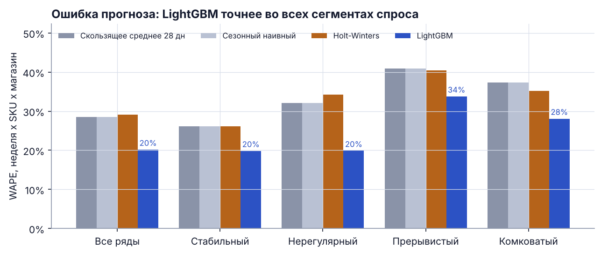
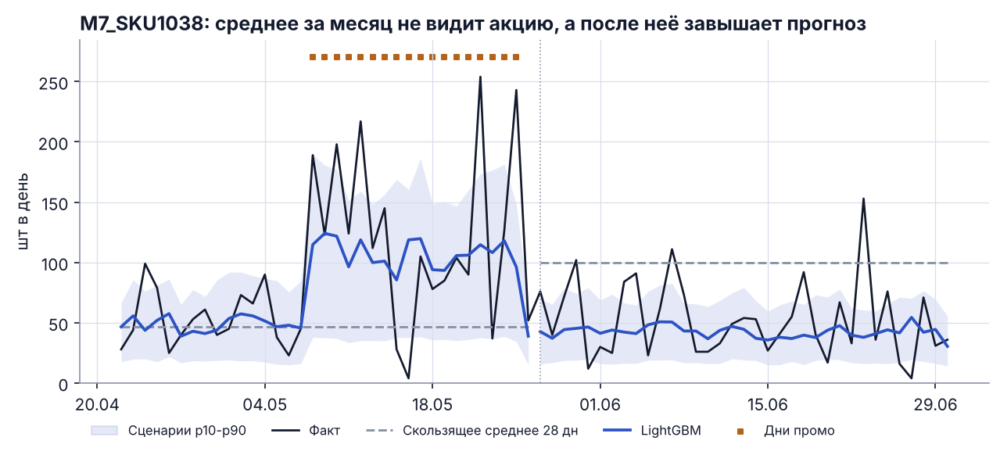
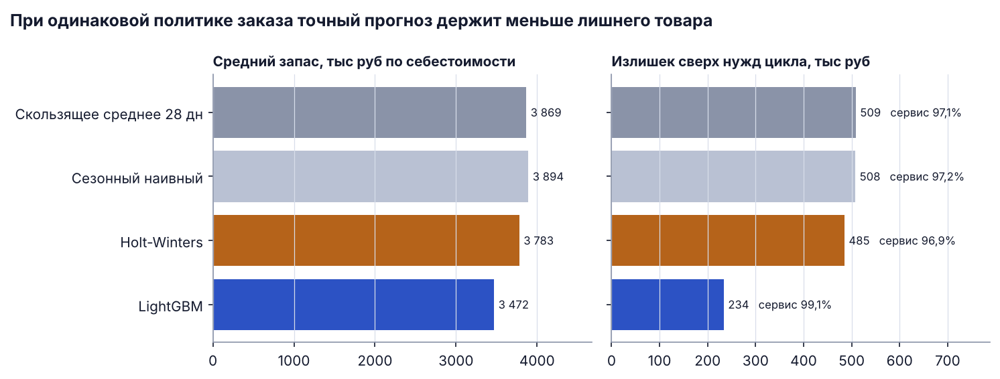
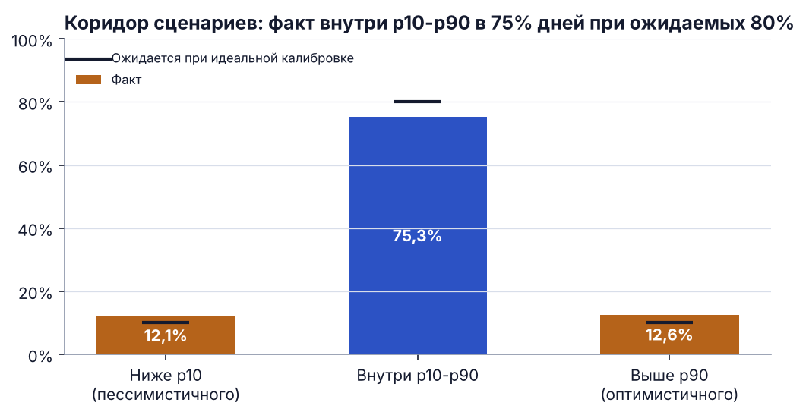
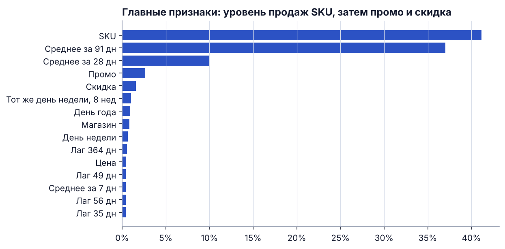

# Прогноз спроса и выручки для розничной сети

*Demand forecasting for a retail chain: LightGBM vs. classic baselines, three demand scenarios and the effect of forecast accuracy on excess stock, on synthetic data that mirrors a 1C sales export.*

## Бизнес-задача

Закупщик заказывает товар по среднему за прошлый месяц. После акций и сезонных пиков такой заказ завышен, и на складе копится лишний товар; в другие недели товара не хватает. Нужно:

1. прогнозировать продажи на 35 дней по каждой паре магазин x SKU точнее текущего способа;
2. дать три сценария спроса (пессимистичный, базовый, оптимистичный) для бюджета закупки;
3. показать эффект в деньгах: сколько запаса и излишков держит сеть при одной и той же политике заказа.

В проекте для заказчика этот подход сократил излишки товара на складе на 30%. Данные заказчика закрыты, поэтому здесь он воспроизведён на синтетических данных той же структуры.

## Данные

Синтетическая выгрузка продаж в структуре отчёта 1С, генератор `src/generate_data.py` с фиксированным seed:

* 8 магазинов, 40 SKU в 5 категориях, дневные продажи с 01.01.2024 по 30.06.2026, 291 840 строк;
* недельная и годовая сезонность, тренд, праздники (Новый год, 23 февраля, 8 марта, майские);
* повышения регулярной цены и промоакции со скидкой 15-30% и эластичным спросом;
* быстрые, средние и медленные товары, в том числе с прерывистым спросом;
* остатки на конец дня: в 3,2% дней товар заканчивался, и продажи там ниже реального спроса.

| Поле | Смысл |
|---|---|
| `date`, `store_id`, `sku_id`, `category` | день, магазин, товар, категория |
| `qty` | продажи, шт |
| `price`, `regular_price` | фактическая и регулярная цена, руб |
| `promo_flag` | товар в акции |
| `stock_end` | остаток на конец дня, шт |

## Подход

| Модель | Идея |
|---|---|
| Скользящее среднее 28 дн | текущая практика: заказ «как в прошлом месяце» |
| Сезонный наивный | среднее того же дня недели за 4 недели |
| Holt-Winters | экспоненциальное сглаживание с затухающим трендом и недельной сезонностью, по каждому ряду |
| **LightGBM** | одна модель на все 320 рядов: лаги, скользящие средние, календарь и праздники, цена, скидка, плановые акции |

* **Без утечки данных.** Все лаги и окна сдвинуты не меньше чем на 35 дней, поэтому прогноз на всё окно строится в день его начала.
* **Цензурированный спрос.** Дни с нулевым остатком исключены из обучения LightGBM, чтобы модель не принимала дефицит за низкий спрос.
* **Бэктест со скользящим началом.** 5 окон по 35 дней (январь-июнь 2026), обучение только на прошлом. Окно 0 калибрует страховой запас, метрики считаются по окнам 1-4.
* **Сценарии.** Квантильные модели LightGBM p10 / p50 / p90.
* **Сегменты спроса.** Классификация Syntetos-Boylan по ADI и CV²: стабильный, нерегулярный, прерывистый, комковатый.
* **Эффект для склада.** Одинаковая политика пополнения для всех моделей: заказ раз в 7 дней, поставка через 2 дня, заказ до уровня «прогноз на 9 дней + страховой запас». Страховой запас = 1,65 x RMSE модели в предыдущем окне x √9, то есть целевой сервис около 95%. Различается только прогноз.

## Результаты

### Точность прогноза (окна 1-4)

| Модель | WAPE, неделя x SKU x магазин | WAPE выручки, магазин x неделя | WAPE, день x SKU x магазин | Смещение |
|---|---|---|---|---|
| Скользящее среднее 28 дн | 28,5% | 9,8% | 52,7% | +0,4% |
| Сезонный наивный | 28,5% | 9,8% | 56,6% | +0,4% |
| Holt-Winters | 29,1% | 9,0% | 52,9% | +0,4% |
| **LightGBM** | **20,2%** | **5,7%** | **47,5%** | **-2,2%** |

Недельная ошибка по паре магазин x SKU ниже на 29% относительно скользящего среднего, ошибка прогноза выручки магазина за неделю ниже на 42%.



LightGBM точнее во всех сегментах спроса, сильнее всего в нерегулярном (19,9% против 32,1%), где спрос двигают акции и праздники.



Типичная ошибка ручного заказа видна на примере: во время акции среднее за месяц занижает спрос, а после неё завышает прогноз почти вдвое, потому что в окно попали промо-дни. LightGBM знает о плановой акции и сразу возвращается к обычному уровню.

### Эффект для склада

Среднее по 4 окнам по 28 дней, запас по себестоимости.

| Модель | Средний запас, руб | Излишек, руб | Уровень сервиса | Дней дефицита | Оборачиваемость, дней |
|---|---|---|---|---|---|
| Скользящее среднее 28 дн | 3 868 919 | 508 923 | 97,1% | 2,1% | 6,8 |
| Сезонный наивный | 3 894 032 | 507 875 | 97,2% | 2,0% | 6,8 |
| Holt-Winters | 3 783 025 | 485 417 | 96,9% | 2,3% | 6,7 |
| **LightGBM** | **3 471 514** | **233 991** | **99,1%** | **0,9%** | **6,0** |

Против заказа по среднему за месяц LightGBM даёт:

* **излишек товара на складе -54,0%**;
* средний запас -10,3%, оборачиваемость 6,8 → 6,0 дней;
* уровень сервиса 97,1% → 99,1%, потерянные продажи за 4 окна 1 951 610 → 687 810 руб (-65%).

Излишек здесь означает остаток сверх фактической потребности следующих 9 дней. На синтетике эффект сильнее, чем в реальном проекте: в данных нет сроков годности, кратности упаковки и минимальной партии поставщика.



### Сценарии спроса

Факт попадает в коридор p10-p90 в 75,3% дней при ожидаемых 80%, ниже p10 в 12,1%, выше p90 в 12,6%. Коридор немного уже идеального, для бюджета закупки его стоит расширить калибровкой на истории.



### Признаки

Главные признаки: уровень продаж SKU (средние за 91 и 28 дней), затем промо и размер скидки.



## Что это даёт бизнесу

* Меньше денег заморожено в стоке: при той же политике заказа излишек вдвое меньше, запас оборачивается быстрее.
* Меньше пустых полок: прогноз учитывает акции и праздники, поэтому дефицит случается реже.
* Бюджет закупки в трёх сценариях вместо одной цифры.
* Прогноз выручки магазина на неделю с ошибкой около 6% для финансового плана.

## Структура репозитория

```
retail-demand-forecasting/
├── data/raw/
│   ├── sales_daily.csv.gz        # синтетическая выгрузка продаж
│   └── sku_catalog.csv           # справочник SKU
├── notebooks/
│   └── 01_demand_forecasting.ipynb   # анализ с выводами, исполнен
├── reports/
│   ├── figures/                  # графики из README
│   ├── metrics_accuracy.csv      # точность по моделям
│   ├── metrics_by_segment.csv    # WAPE по сегментам спроса
│   ├── inventory_effect.csv      # эффект для склада
│   └── backtest_forecasts.csv.gz # прогнозы всех моделей по окнам
├── src/
│   ├── generate_data.py          # генератор данных
│   ├── calendar_ru.py            # праздники
│   ├── features.py               # загрузка, сегменты, признаки
│   ├── models.py                 # бейзлайны, Holt-Winters, LightGBM
│   ├── evaluate.py               # бэктест и метрики
│   ├── inventory_sim.py          # симуляция пополнения
│   ├── plots.py                  # графики
│   └── run_pipeline.py           # полный прогон одной командой
└── requirements.txt
```

## Как запустить

```bash
pip install -r requirements.txt
python -m src.run_pipeline          # данные, бэктест, метрики, графики: около 5 минут
python -m src.run_pipeline --reuse  # пересчёт отчётов по сохранённым прогнозам: несколько секунд
```

Ноутбук: `jupyter notebook notebooks/01_demand_forecasting.ipynb`.

## Стек

Python, pandas, NumPy, LightGBM, statsmodels (Holt-Winters), joblib, matplotlib, Jupyter.
